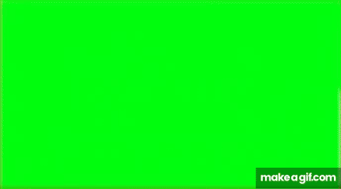
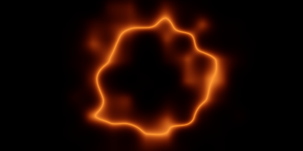

# Semana 9 - *Shaders*


## Trabajo realizado

Se ha realizado la implementación de un *fragment shader*,
cuidando que no superara los **512 bytes** de tamaño.


### Inspiración del *shader*

El *shader* creado está inspirado en un efecto visual que adquirió cierta popularidad en 2025:



### Resultado

El resultado final del *shader*,
si bien no es exactamente igual que su inspiración,
produce un efecto visual con cierta similitud.



Se ha utilizado [twigl.app](https://twigl.app/)
para generar el *gif* a partir del código del *shader*.


### Detalles del código

El código fuente está muy comprimido.
Para facilitar la comprensión del mismo,
a continuación se muestra reescrito de forma más legible.

```glsl
precision mediump float;

uniform vec2 u_resolution;
uniform float u_time;

float r(vec2 p){
    return fract(sin(dot(p,vec2(12,78)))*4e4);
}

float n(vec2 p){
    vec2 i=floor(p),f=fract(p);
    f*=f*(3.-2.*f);
    return mix(
        mix(r(i),r(i+vec2(1,0)),f.x),
        mix(r(i+vec2(0,1)),r(i+1.),f.x),f.y
    );
}

void main(){
    vec2 p=(gl_FragCoord.xy*2.-u_resolution)/u_resolution.y;
    float h=0.,u;
    for(float i=0.;i<5.;i++){
        u=fract(u_time/1.3+i*.2)*2.6;
        h+=max(u-u*u,0.)*4.*exp(-9.*abs(length(p)-u*1.6+.3-n(p*4.-u*1.5)*.4));
    }
    
    gl_FragColor=vec4(h,h*h*.6,h*h*h*.2,1);
}
```

- La función `r(p)` genera un número aleatorio a partir de un punto `p`.
- La función `n(p)` interpola la posición con los números aleatorios para generar ruido.
- El bucle principal (`main()`) genera 5 ondas centradas en el centro del *display*, les aplica la función de ruido para generar el patrón aleatorio y calcula el color.

El `main()` genera 5 ondas con un 20% de desfase
y 2,6 segundos de duración.

## Uso de IA

Se han utilizado herramientas de inteligencia artificial
para comprimir el *shader*
hasta estar dentro del límite de bytes estipulado.
Esto es, tanto la refactorización del código para simplificar nombres de funciones y variables,
como simplificar la matemática del shader por una más sencilla.

## Créditos

- [twigl.app](https://twigl.app/)
- [gif de inspiración](https://makeagif.com/gif/eye-of-rah-explosions-green-screen-JIh6xY) 